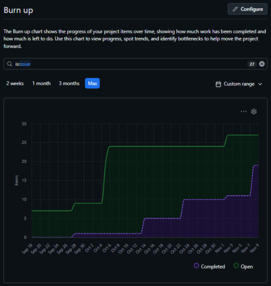

# Metrics & EVM Report
**Project:** Build Me Up: Field Operations & Change Management Portal
**Course:** MIST 320

---

## 1. Velocity & Burn-Up Performance Analysis

### 1.1 Sprint Velocity

| Sprint | Items | Points Committed | Points Completed |
|---|---|---|---|
| Sprint 1 | 9 | 47 | 47 |
| Sprint 2 | 8 | 31 | 31 |
| Sprint 3 (planned) | 7 | 30 | — |
| **Total** | **24** | **108** | **78** |

**Velocity trend:**
- Sprint 1 velocity: **47 points**
- Sprint 2 velocity: **31 points**
- Change: **−16 points (−34%)**
- Average velocity: (47 + 31) ÷ 2 = **39 points per sprint**

The team completed 100% of its committed story points in both Sprint 1 and Sprint 2. Velocity decreased from Sprint 1 to Sprint 2 because fewer points were committed in Sprint 2. Sprint 1 contained larger items, including two 8-point items (System Design and Database Design), averaging 5.2 points per item, while Sprint 2 averaged 3.9 points per item. The 30 points planned for Sprint 3 are below the team's 39-point average velocity.

### 1.2 Burn-Up Chart

*Figure 1: Burn-up chart from GitHub Projects Insights.*

The green line shows total project scope (open items) and the purple line shows completed items. By the end of Sprint 2, 19 of 27 items are complete, including all Sprint 1 and Sprint 2 items.

---

## 2. Earned Value Management (EVM) Calculations

### 2.1 Baseline Values

- **Budget at Completion (BAC):** $300,000
- **Total story points:** 108
- **Story points completed through Sprint 2:** 78
- Per the assignment, 2/3 of total story points and budget are used for Planned Value and Actual Cost at the end of Sprint 2.

### 2.2 Baseline Metrics (End of Sprint 2)

**Planned Value (PV)**
> PV = 2/3 × BAC = 2/3 × $300,000 = **$200,000** (72 story points)

**Earned Value (EV)**
> EV = (Completed Points ÷ Total Points) × BAC = (78 ÷ 108) × $300,000 = **$216,667**

**Actual Cost (AC)**
> AC = 2/3 × BAC = 2/3 × $300,000 = **$200,000**

**Schedule Performance Index (SPI)**
> SPI = EV ÷ PV = $216,667 ÷ $200,000 = **1.08**

**Cost Performance Index (CPI)**
> CPI = EV ÷ AC = $216,667 ÷ $200,000 = **1.08**

An SPI of 1.08 means the project is ahead of schedule, and a CPI of 1.08 means the project is under budget.

### 2.3 Sprint 3 Forecasting

**Estimate at Completion (EAC)**
> EAC = BAC ÷ CPI = $300,000 ÷ 1.0833 = **$276,923**

**Estimate to Complete (ETC)**
> ETC = EAC − AC = $276,923 − $200,000 = **$76,923**

### 2.4 Summary

| Metric | Value |
|---|---|
| Planned Value (PV) | $200,000 |
| Earned Value (EV) | $216,667 |
| Actual Cost (AC) | $200,000 |
| Schedule Performance Index (SPI) | 1.08 |
| Cost Performance Index (CPI) | 1.08 |
| Estimate at Completion (EAC) | $276,923 |
| Estimate to Complete (ETC) | $76,923 |
