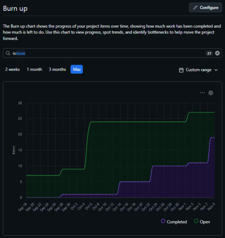

# Metrics & EVM Report
**Project:** Build Me Up: Field Operations & Change Management Portal
**Course:** MIST 320
**Reporting Point:** End of Sprint 2 (November 8, 2026)
**Data Source:** GitHub Projects board *Build_Me_Up_Field_Management* (Table view and Insights)

---

## 1. Executive Summary

At the end of Sprint 2, the Build Me Up team has completed **78 of 108 story points (72%)**. The baseline expected 67% (72 points), so the project is **slightly ahead of schedule and under budget**. Both the Schedule Performance Index (SPI) and the Cost Performance Index (CPI) are **1.08**. If that efficiency holds, the project is forecast to finish at about **$276,923**, which is **$23,077 under** the $300,000 budget.

Velocity dropped from 47 points in Sprint 1 to 31 points in Sprint 2. Sprint 3 has 30 points planned, which is within the team's demonstrated capacity, so on-time completion looks realistic.

| Metric | Value | Status |
|---|---|---|
| Budget at Completion (BAC) | $300,000 / 108 pts | — |
| Planned Value (PV) | $200,000 / 72 pts | — |
| Earned Value (EV) | $216,667 / 78 pts | Ahead |
| Actual Cost (AC) | $200,000 / 72 pts | — |
| Schedule Performance Index (SPI) | **1.08** | Ahead of schedule |
| Cost Performance Index (CPI) | **1.08** | Under budget |
| Estimate at Completion (EAC) | **$276,923** | Under budget |
| Estimate to Complete (ETC) | **$76,923** | — |

---

## 2. Velocity & Burn-Up Performance Analysis

### 2.1 Story Points by Sprint

| Sprint | Items | Points Committed | Points Completed | Completion Rate |
|---|---|---|---|---|
| Sprint 1 | 9 | 47 | 47 | 100% |
| Sprint 2 | 8 | 31 | 31 | 100% |
| Sprint 3 (planned) | 7 | 30 | 6 (in progress) | — |
| **Total** | **24** | **108** | **78 through Sprint 2** | |

*Three backlog items (Worker Wearable Integration, Crane Radius & Geo-fence Management, Crane Lockout & On-Site Siren System) are unassigned to a sprint and unestimated, so they are excluded from the project baseline.*

**Sprint 1 items (47 pts):** Gather Requirements (3), Project Planning (3), Stakeholder Analysis (5), Record Project Expenses (5), Submit Change Requests (5), Submit Safety Report (5), Assign Project User Roles (5), System Design (8), Database Design (8)

**Sprint 2 items (31 pts):** Rate Safety Incident Severity (2), Track Safety Report Status (2), View Project Cost Summaries (3), Track Change Request Status (3), Attach Photos to Safety Reports (3), Compare Projected and Actual Costs (5), Maintain Site Logs (5), Development (8)

**Sprint 3 items (30 pts):** Receive Safety Alerts (3), Receive Critical Project Notifications (3), Final Presentation (3, done), Receive Change Order Notifications (3, done), Documentation (5), Update Project Schedules and Prices (5), Testing (8)

### 2.2 Velocity Trend

| Measure | Sprint 1 | Sprint 2 | Change |
|---|---|---|---|
| Velocity (points completed) | 47 | 31 | −16 (−34%) |
| Items completed | 9 | 8 | −1 |
| Average points per item | 5.2 | 3.9 | −1.3 |

**Average velocity:** (47 + 31) ÷ 2 = **39 points per sprint**

**Analysis:**
- **The team finished everything it committed to in both sprints.** The velocity drop reflects a lighter Sprint 2 commitment, not missed work. This shows reliable sprint planning.
- **Sprint 1 held the heaviest work.** It included two 8-point foundational items (System Design and Database Design) plus five 5-point user stories. Sprint 2 shifted to smaller, feature-level stories (mostly 2–3 points) that build on that foundation.
- **Sprint 1 ran longer.** Its item dates span August 24 to October 25, while Sprint 2 ran two weeks (October 26 to November 8). Per week, Sprint 2's pace was comparable or better, so the raw velocity drop overstates any slowdown.
- **Sprint 3 capacity is sufficient.** The 30 points planned for Sprint 3 are below the 39-point average and roughly match Sprint 2's 31, and 6 points are already done.

### 2.3 Burn-Up Chart

*Figure 1: Burn-up chart from GitHub Projects Insights (item count, full project timeline).*

**Interpretation:**
- **Scope line (green, "Open").** Scope started at 7 items, rose to 9 in late September, and jumped to 24 around October 5 once the team broke the epics into user stories for all three sprints. It rose again to 27 in early November when the three unestimated backlog items were added. The early growth is a normal part of backlog refinement. The final step is future-scope backlog, not added Sprint 3 commitments.
- **Completed line (purple).** Completed work climbs in a stair-step pattern: small gains through mid-October, about 10 items by the end of Sprint 1, then a sharp jump to 19 items on November 8, when all eight Sprint 2 issues were closed (confirmed by repository Pulse activity).
- **Batch closing.** The flat stretches followed by big jumps show that issues were closed in batches at sprint end instead of when each finished. Closing issues as they reach Done would make the chart a more accurate real-time progress signal in Sprint 3.
- **Gap to scope.** Of the 27 items, 19 are complete. The remaining gap is the 5 open Sprint 3 items plus the 3 unscheduled backlog items.

---

## 3. Earned Value Management (EVM) Calculations

### 3.1 Assumptions

- **Budget at Completion (BAC):** $300,000 for 108 story points
- **Value per story point:** $300,000 ÷ 108 = **$2,777.78**
- **Project length:** 3 sprints. By the end of Sprint 2, 2/3 of the work is planned (PV) and 2/3 of the budget is spent (AC), as the assignment specifies.
- **Earned Value** counts only story points completed through the end of Sprint 2 (78 points). The 6 Sprint 3 points already done are left out so the Sprint 2 baseline stays clean.

### 3.2 Baseline Metrics (End of Sprint 2)

**Planned Value (PV)**
> PV = 2/3 × BAC = 2/3 × $300,000 = **$200,000** (72 story points)

**Earned Value (EV)**
> EV = (Completed Points ÷ Total Points) × BAC = (78 ÷ 108) × $300,000 = **$216,667** (78 story points)

**Actual Cost (AC)**
> AC = 2/3 × BAC = 2/3 × $300,000 = **$200,000** (72 story-point equivalents)

**Schedule Performance Index (SPI)**
> SPI = EV ÷ PV = $216,667 ÷ $200,000 = **1.08**

**Cost Performance Index (CPI)**
> CPI = EV ÷ AC = $216,667 ÷ $200,000 = **1.08**

**Supporting variances**
> Schedule Variance (SV) = EV − PV = $216,667 − $200,000 = **+$16,667**
> Cost Variance (CV) = EV − AC = $216,667 − $200,000 = **+$16,667**

### 3.3 Interpretation

| Index | Value | Meaning |
|---|---|---|
| SPI | 1.08 | The team has delivered 8% more work than planned by this point. |
| CPI | 1.08 | Each dollar spent earned about $1.08 of planned value. |

Both indices are above 1.0, so the project is **ahead of schedule and under budget**. PV and AC are both fixed at 2/3 of the budget, so SPI and CPI are equal here. Both come entirely from the team completing 78 points instead of the planned 72.

---

## 4. Sprint 3 Forecasting

### 4.1 Estimate at Completion (EAC)

Assuming the current cost efficiency (CPI = 1.08) continues through Sprint 3:

> EAC = BAC ÷ CPI = $300,000 ÷ 1.0833 = **$276,923** (≈ 99.7 story-point equivalents)

### 4.2 Estimate to Complete (ETC)

> ETC = EAC − AC = $276,923 − $200,000 = **$76,923** (≈ 27.7 story-point equivalents)

### 4.3 Variance at Completion (VAC)

> VAC = BAC − EAC = $300,000 − $276,923 = **+$23,077** (projected savings)

### 4.4 Forecast Summary

| Forecast | Value |
|---|---|
| Remaining work | 30 story points ($83,333 of planned value) |
| Remaining budget | $100,000 |
| Estimate to Complete (ETC) | $76,923 |
| Estimate at Completion (EAC) | $276,923 |
| Projected savings (VAC) | $23,077 (7.7% under budget) |

**Outlook:** The forecast is favorable. The team has averaged 39 points per sprint against 30 points remaining, and 6 Sprint 3 points (Final Presentation and Receive Change Order Notifications) are already done. Sprint 3 should finish within schedule and under budget.

**Risks to watch in Sprint 3:**
- **Testing (8 pts)** is the largest remaining item and is already in progress. Defects found during testing could create rework.
- **Batch closing of issues** could hide schedule slippage until the last days of the sprint. Close issues as soon as they're done.
- **Unestimated backlog items** (wearables, geo-fencing, crane lockout) should stay out of Sprint 3 unless they're estimated and the baseline is re-planned. Pulling them in would be scope creep against the 108-point baseline.

---

## 5. Conclusion

Build Me Up is in a healthy position going into its final sprint. The team has met 100% of its sprint commitments, earned more value than planned (SPI = CPI = 1.08), and is forecast to finish about $23,000 under its $300,000 budget. Sprint 3's main focus should be finishing the Testing and Documentation work, closing issues continuously so the burn-up chart reflects real progress, and keeping the unestimated backlog out of the current baseline.
